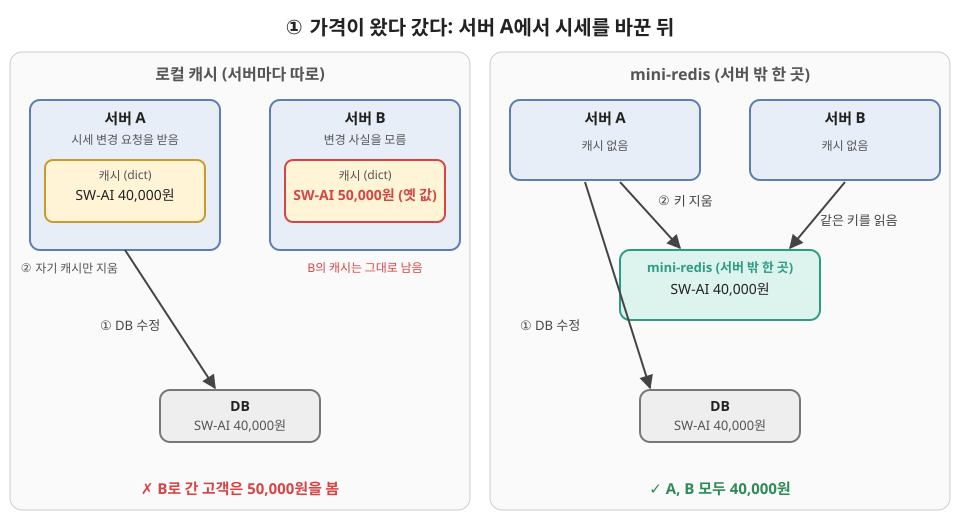
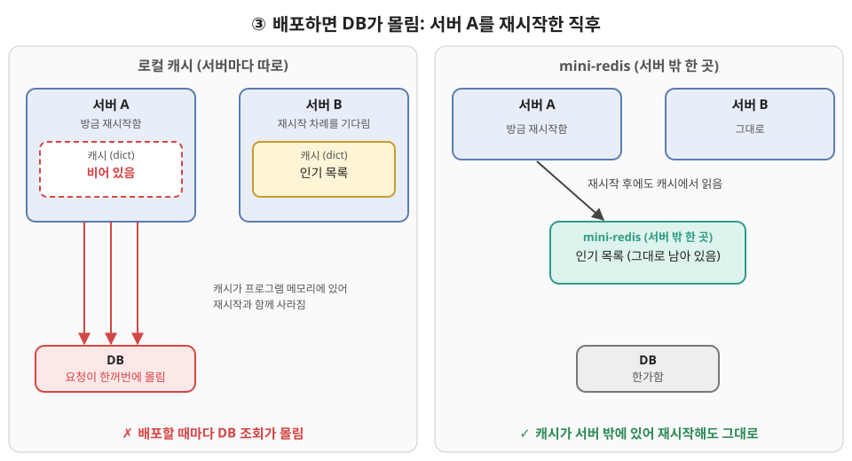
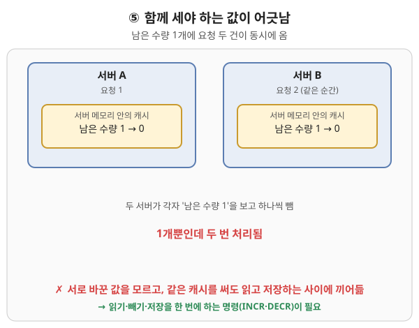

# mini-redis

직접 구현한 해시 테이블 자료구조의 키-값 저장소를 HTTP 서버로 띄우고, 웹 서버 여러 대가 함께 하나의 캐시를 쓰는 것을 구현했습니다.

## 목차

1. [redis는 왜 만들어졌나?](#1-redis는-왜-만들어졌나)
2. [실행 방법](#2-실행-방법)

## 1. redis는 왜 만들어졌나?

캐시는 DB에서 한 번 읽어 온 값을 가까운 메모리에 잠깐 보관해 두었다가, 같은 요청이 다시 오면 DB에 가지 않고 바로 돌려주는 장치입니다. DB는 값을 하나 돌려주기 위해서도 요청을 해석하고, 조건에 맞는 데이터를 찾고, 필요하면 디스크에서 읽어 오는 일을 합니다. 캐시는 키 하나로 메모리에서 값을 바로 꺼내기 때문에 이 과정을 건너뜁니다.

웹 서버가 한 대뿐이라면 캐시는 웹 서버 프로그램 안에 두는 것으로 충분합니다. 모든 요청이 같은 서버로 오고, 그 서버의 메모리는 하나뿐이라서 캐시도 하나뿐이기 때문입니다. 값이 바뀌면 그 캐시에서 지우기만 하면 됩니다.

프로그램 안의 캐시는 네트워크를 거치지 않으니 캐시 중에서 가장 빠릅니다. Redis 같은 캐시는 서버 밖의 별도 프로그램이라 요청마다 네트워크를 한 번 더 오가야 해서, 프로그램 안의 캐시보다 느립니다. **더 빠른 방법을 두고 왜 굳이 캐시를 서버 밖에 두게 되었을까요?**









mini-redis를 직접 만들면서, 다섯 문제의 원인이 모두 같다는 것을 알게 되었습니다. **캐시가 각 서버의 메모리 안에 따로 있다는 것**입니다. Redis는 캐시를 서버 밖의 한 곳으로 빼서, 모든 웹 서버가 같은 캐시를 함께 쓰게 하는 방법으로 이 문제들을 해결합니다.

캐시가 한 곳뿐이므로, 데이터를 바꾼 서버가 Redis에서 그 키를 지우면 다른 서버도 다음 조회 때 새 값을 읽게 됩니다(①). 로그인 세션도 Redis에 저장하므로, 요청이 어느 서버로 가든 같은 세션을 찾아 로그인이 유지됩니다(②). Redis는 웹 서버와 별개의 프로그램이라 웹 서버를 재시작해도 캐시가 사라지지 않고, 재시작한 서버도 곧바로 캐시에서 값을 읽습니다(③). 한 서버가 DB에서 읽어 채운 값을 다른 서버도 그대로 쓰므로, 같은 데이터를 서버마다 따로 조회하거나 저장하지 않습니다(④). 여러 서버가 함께 바꾸는 값은 `INCR`·`DECR`처럼 값을 읽고 바꾸는 일을 명령 하나로 처리해서, 그 사이에 다른 요청이 끼어들지 못하게 합니다(⑤).

캐시를 서버 밖에 두면 요청마다 네트워크를 한 번 더 오가야 해서 프로그램 안의 캐시보다 조금 느립니다. 하지만 그 비용은 DB 조회보다 훨씬 작고, 그 대신 모든 서버가 같은 값을 보게 됩니다. 조금 느려지는 것을 받아들이고 서버 사이에 값이 어긋나지 않는 쪽을 고른 것입니다.

## 2. 실행 방법

배포된 화면: https://mini-stock-tu7t.onrender.com (Render 무료, 15분 동안 아무도 안 쓰면 잠들어 첫 접속이 30초쯤 걸립니다)

```bash
python -m venv .venv
source .venv/bin/activate          # Windows: .venv\Scripts\activate
pip install -r requirements.txt
```

| 하고 싶은 것 | 명령 |
| --- | --- |
| mini-redis 서버 띄우기 (포트 8000) | `python -m mini_redis.server` |
| 서버 두 대 시연 (로컬 캐시 vs mini-redis, 약 20초) | `python -m demo.scenario` |
| 시연을 한 단계씩 (발표용) | `python -m demo.scenario --step` |
| 성능 비교 (mini-redis, 데모 API를 먼저 띄운 뒤) | `python -m demo.app` → `python -m bench.benchmark` |
| 주식 화면 (데모 API를 먼저 띄운 뒤, 포트 8010) | `python -m stock.server` |
| 세 서버를 한 번에 (배포와 같은 방식) | `python -m deploy.start` |
| 전체 테스트 | `python -m unittest -v` |

직접 요청을 보내 보려면 (mini-redis를 띄운 상태에서):

```bash
curl -X POST localhost:8000/set -H "Content-Type: application/json" -d '{"key":"name","value":"mini","ttl":5}'
curl "localhost:8000/get?key=name"        # 200 {"key":"name","value":"mini"}
# 5초 뒤
curl "localhost:8000/get?key=name"        # 404 {"error":"not found"}
```

## 더 보기

| 더 보기 | 문서 |
| --- | --- |
| 3. 구조 | [docs/readme/structure.md](docs/readme/structure.md) |
| 4. API | [docs/readme/api.md](docs/readme/api.md) |
| 5. 해시 테이블은 이렇게 동작한다 | [docs/readme/hashtable.md](docs/readme/hashtable.md) |
| 6. 성능 비교 | [docs/readme/performance.md](docs/readme/performance.md) |
| 7. 테스트 | [docs/readme/tests.md](docs/readme/tests.md) |
| 8. 실제 Redis와 다른 점 | [docs/readme/redis-differences.md](docs/readme/redis-differences.md) |
| 9. 결정 기록과 문서 모음 | [docs/readme/documents.md](docs/readme/documents.md) |
