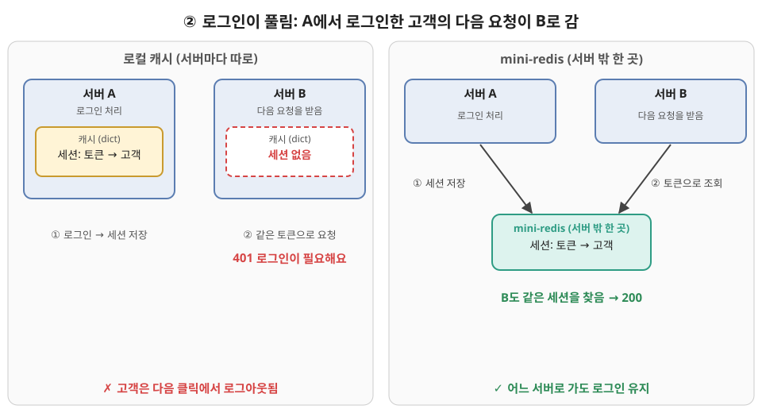
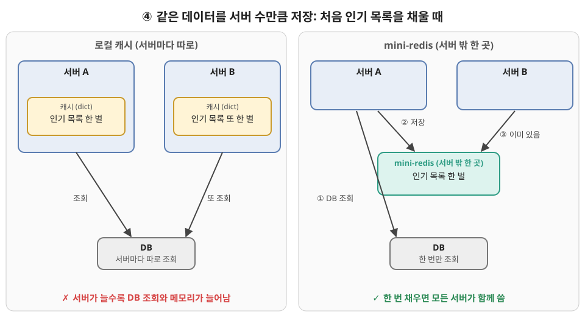
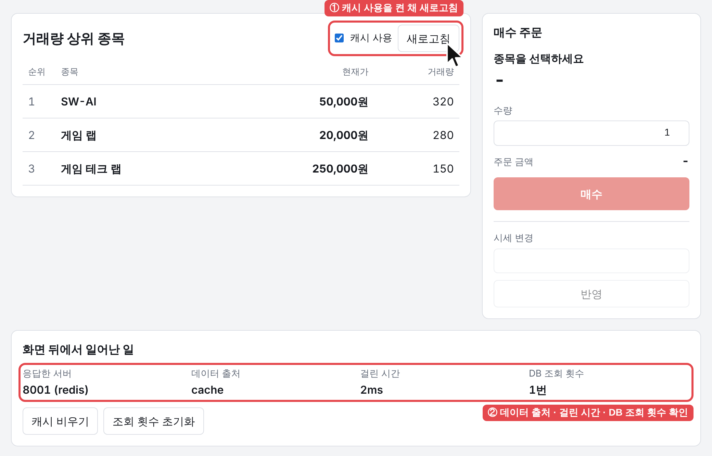
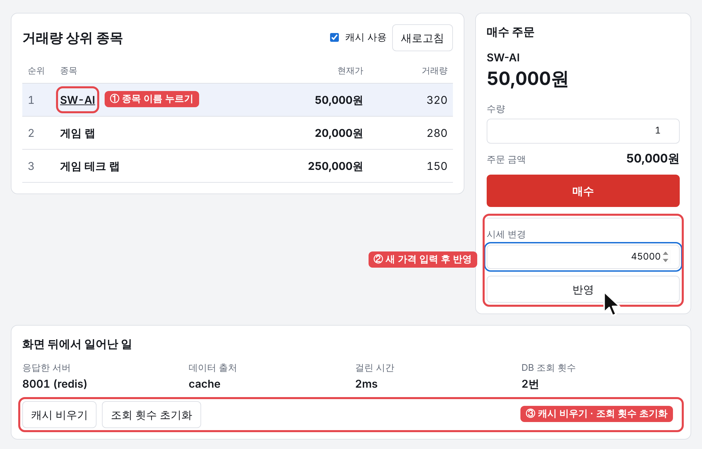
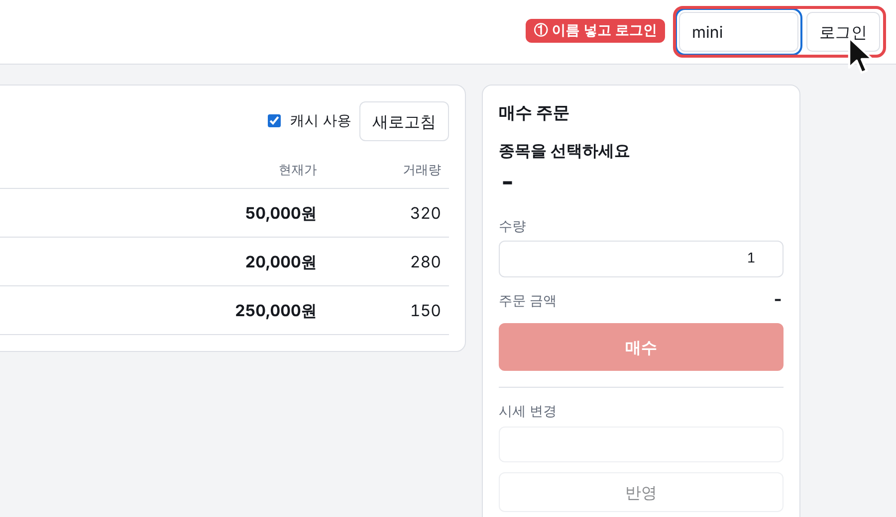

# mini-redis

직접 구현한 해시 테이블 자료구조의 키-값 저장소를 HTTP 서버로 띄우고, 웹 서버 여러 대가 함께 하나의 캐시를 쓰는 것을 구현했습니다.

## 목차

1. [redis는 왜 만들어졌나?](#1-redis는-왜-만들어졌나)
2. [실행 방법](#2-실행-방법)
3. [직접 실행](#3-직접-실행)

## 1. redis는 왜 만들어졌나?

캐시는 DB에서 한 번 읽어 온 값을 가까운 메모리에 잠깐 보관해 두었다가, 같은 요청이 다시 오면 DB에 가지 않고 바로 돌려주는 장치입니다. DB는 값을 하나 돌려주기 위해서도 요청을 해석하고, 조건에 맞는 데이터를 찾고, 필요하면 디스크에서 읽어 오는 일을 합니다. 캐시는 키 하나로 메모리에서 값을 바로 꺼내기 때문에 이 과정을 건너뜁니다.

웹 서버가 한 대뿐이라면 캐시는 웹 서버 프로그램 안에 두는 것으로 충분합니다. 모든 요청이 같은 서버로 오고, 그 서버의 메모리는 하나뿐이라서 캐시도 하나뿐이기 때문입니다. 값이 바뀌면 그 캐시에서 지우기만 하면 됩니다.

프로그램 안의 캐시는 네트워크를 거치지 않으니 캐시 중에서 가장 빠릅니다. Redis 같은 캐시는 서버 밖의 별도 프로그램이라 요청마다 네트워크를 한 번 더 오가야 해서, 프로그램 안의 캐시보다 느립니다. **더 빠른 방법을 두고 왜 굳이 캐시를 서버 밖에 두게 되었을까요?**








mini-redis를 직접 만들면서, 다섯 문제의 원인이 모두 같다는 것을 알게 되었습니다. **문제는 캐시가 각 서버의 메모리 안에 따로 있다는 것**입니다. Redis는 캐시를 서버 밖의 한 곳으로 빼서, 모든 웹 서버가 같은 캐시를 함께 쓰게 하는 방법으로 이 문제들을 해결합니다.

캐시를 서버 밖에 두면 요청마다 네트워크를 한 번 더 오가야 해서 프로그램 안의 캐시보다 조금 느립니다. 하지만 그 비용은 DB 조회보다 훨씬 작고, 그 대신 모든 서버가 같은 값을 보게 됩니다. 조금 느려지는 것을 받아들이고 서버 사이에 값이 어긋나지 않는 쪽을 고른 것입니다.

## 2. 실행 방법

https://mini-stock-tu7t.onrender.com

링크를 열면 mini-redis를 캐시로 쓰는 주식 매수 화면이 나옵니다. 따로 설치할 것은 없습니다. 오랫동안 아무도 접속하지 않았다면 첫 화면이 늦게 뜰 수 있으니 조금만 기다려주세요.



화면 왼쪽의 **거래량 상위 종목** 목록은 DB에서 읽어 오는 데이터입니다. 이 데모의 DB는 일부러 조회마다 3초가 걸리게 만들어 두었습니다. **캐시 사용**을 켠 채 **새로고침**을 누르면 첫 조회만 DB에 가고, 그다음부터는 mini-redis에 저장된 값을 바로 받아 옵니다. 아래의 **화면 뒤에서 일어난 일**에서 데이터 출처(캐시인지 DB인지), 걸린 시간, 지금까지의 DB 조회 횟수를 확인할 수 있습니다. **캐시 사용**을 끄고 새로고침하면 매번 DB로 가서 3초씩 걸리고 DB 조회 횟수가 계속 늘어나는 것을 볼 수 있습니다.



종목 이름을 누르면 오른쪽 **매수 주문**에 그 종목이 선택됩니다. **시세 변경**에 새 가격을 넣고 **반영**을 누르면 DB의 가격을 바꾼 뒤 캐시에서 그 데이터를 지웁니다. 그래서 바로 다음 조회는 DB에서 새 가격을 읽어 오고, 그 뒤로는 다시 캐시에서 새 가격을 받아 옵니다. **캐시 비우기**는 캐시를 직접 비우고, **조회 횟수 초기화**는 DB 조회 횟수를 0으로 되돌립니다.



오른쪽 위에서 이름을 넣고 **로그인**하면 로그인 정보(세션)가 mini-redis에 30분 동안 저장됩니다. 새로고침해도 로그인이 유지되는 것은 서버가 mini-redis에서 세션을 찾기 때문입니다. 로그인한 상태에서 종목을 고르고 **수량**을 넣으면 **주문 금액**이 계산되고, **매수**를 누르면 주문이 미니 DBMS에 저장됩니다. 저장된 주문은 체결 내역에, 산 종목과 남은 잔고는 보유 종목과 잔고에 나타납니다.

## 3. 직접 실행

코드를 받아 내 컴퓨터에서 직접 돌려 보는 방법입니다. Python 3과 Git이 설치되어 있어야 합니다. 아래 명령은 모두 터미널에 입력합니다. Windows에서는 PowerShell을 쓰되, `curl`이 나오는 4단계만 Git Bash에서 실행하는 것이 편합니다.

### 1단계: 코드 받기

```bash
git clone https://github.com/team1-mini-lab/mini-redis.git
cd mini-redis
```

첫 줄은 저장소를 내 컴퓨터에 `mini-redis` 폴더로 내려받고, 둘째 줄은 그 폴더로 들어갑니다. 이후의 명령은 모두 이 폴더 안에서 입력합니다.

### 2단계: 실행 준비 (처음 한 번만)

```bash
python -m venv .venv
```

이 프로젝트에서만 쓰는 파이썬 환경을 `.venv` 폴더에 만듭니다. 다른 프로젝트에 설치한 패키지와 섞이지 않게 하기 위해서입니다.

```bash
source .venv/bin/activate        # macOS, Linux
.venv\Scripts\activate           # Windows
```

방금 만든 환경을 켭니다. 켜지면 터미널 줄 앞에 `(.venv)`가 붙습니다. 터미널을 새로 열 때마다 이 명령을 다시 입력해야 합니다.

```bash
pip install -r requirements.txt
```

필요한 패키지 두 개(HTTP 서버를 만드는 Flask, 서버끼리 요청을 주고받는 requests)를 설치합니다.

### 3단계: 미니 증권 화면을 내 컴퓨터에서 띄우기

```bash
python -m deploy.start
```

mini-redis(포트 8000), 데모 API(포트 8001), 미니 증권 화면(포트 8010) 세 서버를 차례로 띄웁니다. 배포된 사이트와 같은 방식입니다. 세 서버가 모두 뜨면 브라우저에서 `http://localhost:8010`을 열어 2장에서 설명한 화면을 그대로 써 볼 수 있습니다. 끝낼 때는 터미널에서 `Ctrl + C`를 누르면 세 서버가 함께 꺼집니다.

### 4단계: mini-redis에 직접 요청 보내 보기

```bash
python -m mini_redis.server
```

mini-redis 서버만 포트 8000에 띄웁니다. 이 터미널은 서버가 쓰고 있으니 그대로 두고, 터미널을 하나 더 열어 아래 명령을 차례로 입력합니다.

```bash
curl -X POST localhost:8000/set -H "Content-Type: application/json" -d '{"key":"name","value":"mini","ttl":5}'
```

키 `name`에 값 `mini`를 5초 동안 저장합니다. `{"ok":true}`가 돌아오면 저장된 것입니다.

```bash
curl "localhost:8000/get?key=name"
```

저장한 값을 꺼냅니다. `{"key":"name","value":"mini"}`가 돌아옵니다. 5초가 지난 뒤 같은 명령을 다시 입력하면 만료되어 `{"error":"not found"}`가 돌아옵니다.

```bash
curl -X DELETE "localhost:8000/delete?key=name"
```

키를 지웁니다. 지운 키가 있었으면 `{"deleted":true}`, 없었으면 `{"deleted":false}`가 돌아옵니다.

### 5단계: 서버 여러 대 장면 재현하기

```bash
python -m demo.scenario
```

1장의 장면을 직접 재현합니다. 같은 데모 API를 두 대씩 띄우고, 서버마다 캐시를 따로 두는 경우와 mini-redis 하나를 함께 쓰는 경우에 똑같은 순서로 요청을 보낸 뒤, 결과를 표로 나란히 보여 줍니다. 서버는 이 명령이 알아서 띄우고 끄므로 다른 서버를 미리 띄울 필요가 없습니다. 20초쯤 걸립니다. 끝에 `--step`을 붙이면 `Enter`를 누를 때마다 한 단계씩 진행합니다.

### 6단계: 캐시를 쓸 때와 안 쓸 때 속도 비교하기

터미널 세 개를 열고, 각 터미널에서 2단계의 환경 켜기 명령을 먼저 입력한 뒤 하나씩 실행합니다.

```bash
python -m mini_redis.server      # 터미널 1
python -m demo.app               # 터미널 2
python -m bench.benchmark        # 터미널 3
```

터미널 1과 2는 mini-redis와 데모 API를 띄워 둡니다. 터미널 3의 측정 스크립트는 같은 목록을 캐시 없이 10번, 캐시를 써서 10번 조회하고 평균·최소·최대 응답 시간과 DB 조회 횟수를 표로 보여 줍니다. 데모의 DB는 조회마다 3초가 걸리게 만들어 두어서, 캐시 없이 조회하는 부분에만 30초쯤 걸립니다.

### 7단계: 테스트 실행하기

```bash
python -m unittest -v
```

`tests/` 폴더의 테스트 63개를 모두 실행합니다. 테스트마다 이름과 결과가 한 줄씩 나오고, 마지막 줄에 `OK`가 나오면 모두 통과한 것입니다. 서버를 미리 띄울 필요는 없습니다.

## 더 보기

| 더 보기 | 문서 |
| --- | --- |
| 4. 구조 | [docs/readme/structure.md](docs/readme/structure.md) |
| 5. API | [docs/readme/api.md](docs/readme/api.md) |
| 6. 해시 테이블은 이렇게 동작한다 | [docs/readme/hashtable.md](docs/readme/hashtable.md) |
| 7. 성능 비교 | [docs/readme/performance.md](docs/readme/performance.md) |
| 8. 테스트 | [docs/readme/tests.md](docs/readme/tests.md) |
| 9. 실제 Redis와 다른 점 | [docs/readme/redis-differences.md](docs/readme/redis-differences.md) |
| 10. 결정 기록과 문서 모음 | [docs/readme/documents.md](docs/readme/documents.md) |
